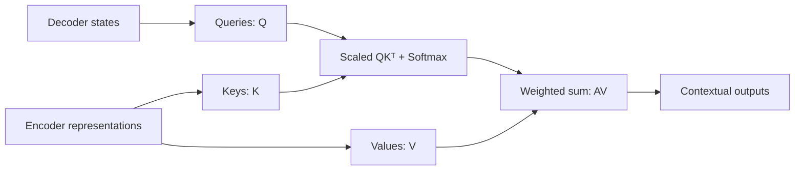

> **학습 노트의 범위**  
> Stanford **CS231n, Spring 2025 — Lecture 8: Attention and Transformers** (Justin Johnson)를 바탕으로 작성했다. 강의의 흐름과 수식은 [공식 슬라이드](https://cs231n.stanford.edu/slides/2025/lecture_8.pdf) **개념을 이해하기 위한 예시, 수식의 추가 유도, PyTorch 코드 및 실무적 주의사항은 필자의 보충 설명**이며 영상 발화를 그대로 옮긴 것은 아니다. RNN Encoder–Decoder에서 Attention이 등장한 배경부터 Q, K, V, Self-Attention, Multi-Head Attention, Transformer, ViT, FlashAttention, Pre-Norm, RMSNorm, SwiGLU, MoE까지
{: .prompt-info }

## 강의 정보

- **강의:** Stanford CS231n — Deep Learning for Computer Vision (Spring 2025)
- **주제:** Lecture 8 — Attention and Transformers
- **강사:** Justin Johnson
- **강의일:** 2025년 4월 24일
- **영상:** [Stanford Online 공식 YouTube](https://www.youtube.com/watch?v=RQowiOF_FvQ)
- **자료:** [Lecture 8 공식 슬라이드 (PDF)](https://cs231n.stanford.edu/slides/2025/lecture_8.pdf) ,  [2025 강의 일정](https://cs231n.stanford.edu/2025/schedule.html)



## 0. 전체 흐름: Attention은 왜 필요했고 Transformer는 무엇을 바꾸었는가?

이 강의는 단순히 Transformer의 공식을 외우는 것보다 **그 구조가 어떻게 등장했는지**를 설명한다. 시작점은 RNN 기반 기계번역이다.

1. 고전적인 **RNN Encoder–Decoder**는 긴 입력을 하나의 고정 길이 벡터에 압축해야 한다.
2. **Attention**은 디코더가 매 시점 전체 입력을 다시 참조하게 하여 병목을 완화한다.
3. Attention을 독립적인 연산으로 추상화하면 **Query–Key–Value(QKV)** 구조가 된다.
4. 입력 집합이 스스로를 참조하면 **Self-Attention**이 된다.
5. 이를 병렬로 여러 번 수행하면 **Multi-Head Attention**이 된다.
6. Attention과 위치별 MLP, 정규화, 잔차 연결을 쌓으면 **Transformer**가 된다.
7. 언어에서는 **causal masking**, 이미지에서는 **patch embedding**을 적용해 사용할 수 있다.
8. 최근에는 **FlashAttention, Pre-Norm, RMSNorm, SwiGLU, MoE** 등의 개선이 널리 활용된다.

중요한 두가지는 

- **Attention:** 벡터들의 집합을 입력으로 받아, 각 Query에 필요한 정보를 가중합으로 검색, 집계하는 연산
- **Transformer:** Attention을 핵심적인 토큰 간 정보 교환 연산으로 사용하는 신경망 구조


## 1. 출발점: RNN Encoder–Decoder와 고정 길이 정보 병목

### 1.1 Sequence-to-Sequence(Seq2Seq) 문제

기계번역을 생각하자. 영어 문장 `we see the sky`를 이탈리아어 문장 `vediamo il cielo`로 번역한다면 입력과 출력 길이도, 단어 순서도 달라진다.

기존 Seq2Seq 아키텍처는 **Encoder RNN**과 **Decoder RNN**을 사용한다.

- Encoder는 입력 토큰을 순서대로 읽어 hidden state를 업데이트한다.
- 마지막 hidden state를 입력 문장의 압축 표현, 즉 *context vector*로 사용한다.
- Decoder는 context vector와 이전 출력 토큰을 사용해 다음 토큰을 예측한다.

Encoder는 보통 다음과 같이 표현한다.

$$
h_t = f_W(x_t, h_{t-1})
$$

- $x_t$: $t$번째 입력의 임베딩
- $h_t$: $t$번째 입력까지 읽었을 때의 hidden state
- $f_W$: 파라미터 $W$를 공유하는 RNN/LSTM/GRU 등의 상태 갱신 함수

고전적인 방식에서는 최종 hidden state를 context vector로 둔다.

$$
c = h_T
$$

Decoder의 상태 갱신은 개념적으로 다음과 같다.

$$
s_t = g_U(y_{t-1}, s_{t-1}, c)
$$

여기서 $s_t$는 Decoder 상태, $y_{t-1}$는 이전 출력 토큰, $c$는 입력 전체의 요약이다.

### 1.2 무엇이 문제인가?

입력 문장의 길이가 5개일 때와 1,000개일 때 모두 **동일한 차원의 $c$ 하나**에 정보를 압축해야 한다. 마지막 hidden state가 모든 단어의 세부 관계를 완벽하게 보존한다는 보장은 없다.

특히 출력 토큰마다 필요한 입력 정보는 다르다.

- `vediamo`를 출력할 때는 `we`와 `see`가 중요하다.
- `il`을 출력할 때는 `the`가 중요하다.
- `cielo`를 출력할 때는 `sky`가 중요하다.

그런데 입력을 요약한 **같은 $c$를 모든 출력 단계에 반복해서 사용**하면, Decoder가 매 순간 필요한 입력 위치를 선택하기 어렵다.

> 핵심 문제는 **고정 길이 context vector를 통과해야 하는 정보 병목(bottleneck)** 이다. 해결 방향은 Decoder가 출력할 때마다 Encoder의 전체 hidden state를 직접 살펴보도록 하는 것이다.
{: .prompt-tip }

---

## 2. Encoder–Decoder Attention: 매 시점마다 입력을 다시 살펴보기

### 2.1 Bahdanau Attention의 핵심 아이디어

[Neural Machine Translation by Jointly Learning to Align and Translate](https://arxiv.org/abs/1409.0473)에서 제시된 방식은 Decoder의 현재 상황을 바탕으로 Encoder hidden state들의 중요도를 계산한다.

Decoder의 $t$번째 출력에 대해 이전 Decoder 상태 $s_{t-1}$와 각 Encoder 상태 $h_i$의 연관성을 평가한다.

$$
e_{t,i} = f_{\mathrm{att}}(s_{t-1},h_i)
$$

- $e_{t,i}$: 디코더 시점 $t$에서 입력 위치 $i$에 대한 **정렬 점수(alignment score)**
- $f_{\mathrm{att}}$: 학습 가능한 점수 함수
- 점수가 클수록 해당 입력 위치가 현재 출력에 중요하다고 판단한다.

> 이 강의에서는 직관적으로 점수 함수를 학습 가능한 선형 계층으로 설명한다. 실제 Bahdanau 논문의 *additive attention*은 일반적으로 $$v^\top\tanh(W_s s_{t-1}+W_hh_i)$$와 같은 형태로 구현한다. 따라서 **점수 함수의 구체적인 형태**와 **Attention의 전체 원리**는 구분해야 한다.
{: .prompt-info }

### 2.2 점수를 확률적 가중치로 바꾸기: Softmax

원시 점수 $e_{t,i}$는 제한 없는 실수다. 이를 Softmax로 정규화한다.

$$
a_{t,i}
= \frac{\exp(e_{t,i})}{\sum_{j=1}^{T}\exp(e_{t,j})}
$$

정규화 후에는 다음을 만족한다.

$$
0 < a_{t,i} < 1,\qquad \sum_{i=1}^{T}a_{t,i}=1
$$

각 $a_{t,i}$가 *attention weight*다. 즉, Decoder가 현재 어느 입력 위치를 얼마나 참고할지 나타내는 가중치다.

### 2.3 Context vector는 가중합(Weighted Sum)

현재 출력 시점에 필요한 정보를 모든 Encoder hidden state의 가중합으로 얻는다.

$$
c_t = \sum_{i=1}^{T}a_{t,i}h_i
$$

이제 Decoder 상태 갱신에 단일한 $c$가 아닌 **시점별 context vector $c_t$** 를 사용한다.

$$
s_t = g_U(y_{t-1},s_{t-1},c_t)
$$

즉, **각 Decoder step은 입력 전체를 보지만, 서로 다른 방식으로 본다.**

### 2.4 숫자로 이해하는 Attention

`we see the sky`를 입력받고 `vediamo`를 예측한다고 가정하자. 설명을 위한 예시 가중치를 다음처럼 설정할 수 있다.

| 입력 토큰 | `we` | `see` | `the` | `sky` |
|---|---:|---:|---:|---:|
| Attention weight | 0.45 | 0.45 | 0.05 | 0.05 |

반대로 `il`을 예측할 때는 다음과 같은 가중치가 가능하다.

| 입력 토큰 | `we` | `see` | `the` | `sky` |
|---|---:|---:|---:|---:|
| Attention weight | 0.05 | 0.05 | 0.80 | 0.10 |

이렇게 모델이 번역 과정에서 **입력–출력 간 정렬(alignment)** 을 학습한다. Attention weight를 행렬로 시각화하면 어떤 출력 단어가 어떤 입력 단어를 주로 참조하는지 대략적으로 살펴볼 수 있다.

다만 **Attention weight가 반드시 원인적 설명이나 완전한 해석 가능성을 제공하는 것은 아니다.** Attention heatmap은 참조 패턴을 관찰하기 위한 도구로 이해하는 편이 정확하다.

### 2.5 Attention이 만들어 낸 변화

- 고정 길이 context vector에 대한 의존도를 낮춘다.
- 출력 시점마다 입력의 서로 다른 위치를 참조할 수 있다.
- 점수 계산, Softmax, 가중합이 모두 미분 가능하므로 **별도의 정렬 정답 없이 end-to-end 학습**할 수 있다.
- 이 개념은 기계번역을 넘어 다양한 입력 자료에 적용할 수 있다.

---

## 3. Attention을 일반적인 연산으로 추상화하기

원래 Attention은 Encoder–Decoder 안에 들어 있는 보조 장치였다. 그러나 핵심 연산만 분리하면 더 범용적인 형태를 얻을 수 있다.

**'어떤 Query가 주어졌을 때, 데이터 집합에서 관련 있는 정보를 선택해 요약한다'** 는 관점이다.

### 3.1 Query 하나와 데이터 벡터 여러 개

Query 벡터 $q$와 데이터 벡터 $X_1,\ldots,X_M$이 있다고 하자.

1. Query와 각 데이터 사이의 유사도 계산
2. 유사도를 Softmax로 정규화
3. 데이터를 가중합해 Query의 출력 생성

$$
\begin{aligned}
e_j &= f_{\mathrm{att}}(q,X_j) \\
a_j &= \operatorname{softmax}(e)_j \\
y &= \sum_{j=1}^{M}a_jX_j
\end{aligned}
$$

**한 Query는 하나의 출력 벡터를 만든다.**

### 3.2 Dot-Product Attention

Attention 점수는 두 벡터의 내적(dot product)으로 계산할 수 있다.

$$
e_j = q^\top X_j
$$

내적이 클수록(벡터의 크기 영향을 포함하여) 두 표현이 강하게 정렬되었다고 해석할 수 있다. 행렬 곱으로 계산하기 쉬워 GPU 병렬화에도 유리하다.

### 3.3 왜 $\sqrt{d_k}$로 나눌까? — Scaled Dot-Product

차원이 큰 벡터끼리 내적하면 점수의 크기가 커지는 경향이 있다. 큰 점수가 Softmax에 들어가면 분포가 과도하게 뾰족해지고, 특정 영역에서 기울기가 작아져 학습이 어려워질 수 있다.

그래서 Query, Key의 차원을 $d_k$라고 할 때 다음과 같이 스케일링한다.

$$
e_j = \frac{q^\top k_j}{\sqrt{d_k}}
$$

**왜 하필 제곱근인가?** 다음은 강의 내용을 보충하는 간단한 통계적 설명이다.

Query와 Key의 각 성분이 서로 독립이고 평균 0, 분산 1이라는 단순화된 가정을 하자.

$$
q^\top k = \sum_{r=1}^{d_k}q_r k_r
$$

이때 대략적으로

$$
\operatorname{Var}(q^\top k) = d_k
$$

이므로 표준편차는 $$\sqrt{d_k}$$ 수준이다. 따라서 이를 나누면 차원이 달라져도 점수의 스케일을 비교적 일정하게 유지할 수 있다.

> 엄밀히 말하면 실제 학습된 벡터의 성분은 독립, 동분산을 보장하지 않는다. 이 유도는 **스케일링을 설명하는 직관적인 모델**이다.
{: .prompt-info }

### 3.4 점수 → 확률 → 출력의 수치 예시

어떤 Query가 데이터 3개에 대해 점수 $[2,1,0]$을 얻었다고 하자.

$$
\operatorname{softmax}([2,1,0])\approx[0.665,0.245,0.090]
$$

Values가 각각 $v_1=[1,0]$, $v_2=[0,1]$, $v_3=[1,1]$이면,

$$
\begin{aligned}
y &= 0.665[1,0]+0.245[0,1]+0.090[1,1]\\
  &= [0.755,0.335]
\end{aligned}
$$

출력은 여러 Value의 **학습된 가중 평균에 해당하는 조합**이다. Attention 자체가 반드시 특정 Value 하나만 선택하는 하드 검색은 아니다.

---

## 4. Query, Key, Value(QKV): 무엇을 비교하고 무엇을 가져올까?

### 4.1 Query, Key, Value의 역할

Attention을 더 유연하게 만들기 위해 **비교에 쓰는 표현**과 **실제로 가져올 정보**를 분리한다.

| 구성 요소 | 직관적 역할 | 실제 계산에서 하는 일 |
|---|---|---|
| Query ($Q$) | 지금 무엇이 필요한가? | Key와 비교해 attention score를 만든다. |
| Key ($K$) | 어떤 정보가 어디에 있는가? | Query와의 유사도 계산에 사용된다. |
| Value ($V$) | 실제 전달할 정보는 무엇인가? | Attention weight에 따라 가중합된다. |

도서관에 비유하면 Query는 검색어, Key는 색인, Value는 실제로 가져올 정보다. 중요한 점은 이 세 가지가 **학습 가능한 선형 변환을 통해 형성된 벡터**라는 사실이다.

### 4.2 Cross-Attention의 행렬 연산

Query 집합이 $Q\in\mathbb{R}^{N_q\times d_k}$이고, 참조할 데이터가 $X\in\mathbb{R}^{N_k\times d_{\mathrm{in}}}$라고 하자.

Key와 Value는 데이터 $X$로부터 만든다.

$$
K = XW_K,\qquad V=XW_V
$$

각 행렬의 차원은 다음과 같다.

| 텐서 | Shape | 의미 |
|---|---|---|
| $$Q$$ | $$N_q \times d_k$$ | Query 토큰들의 표현 |
| $$X$$ | $$N_k \times d_{\mathrm{in}}$$ | 참조 데이터 토큰들의 표현 |
| $$W_K$$ | $$d_{\mathrm{in}}\times d_k$$ | Key projection |
| $$W_V$$ | $$d_{\mathrm{in}}\times d_v$$ | Value projection |
| $$K$$ | $$N_k\times d_k$$ | Key 벡터들 |
| $$V$$ | $$N_k\times d_v$$ | Value 벡터들 |

Attention은 세 단계로 계산한다.

**① Query–Key 유사도**

$$
E=\frac{QK^\top}{\sqrt{d_k}}
\qquad E\in\mathbb{R}^{N_q\times N_k}
$$

**② Query별 Softmax**

$$
A=\operatorname{softmax}(E,\mathrm{axis}=-1)
\qquad A\in\mathbb{R}^{N_q\times N_k}
$$

**③ Value 가중합**

$$
Y=AV
\qquad Y\in\mathbb{R}^{N_q\times d_v}
$$

세 식을 합치면 가장 중요한 공식이 된다.

$$
\operatorname{Attention}(Q,K,V)
=\operatorname{softmax}\!\left(\frac{QK^\top}{\sqrt{d_k}}\right)V
$$

> **축에 주의:** 여기서는 Query가 **행(row)**, Key가 **열(column)** 이다. 따라서 `softmax(dim=-1)`을 사용하면 각 Query의 가중치 합이 1이 된다. 슬라이드의 일부 도식은 행과 열의 시각적 배치를 반대로 그렸지만, 구현에서는 **텐서 차원과 정규화 축**을 기준으로 확인해야 한다.
{: .prompt-warning }

### 4.3 Cross-Attention이라는 이름의 의미

Cross-Attention은 보통 **Query의 출처와 Key/Value의 출처가 다를 때** 사용한다.

- Transformer Decoder의 현재 상태가 Query가 된다.
- Encoder가 처리한 입력의 표현이 Key와 Value가 된다.
- 출력 토큰은 입력 문장에서 필요한 정보를 선택적으로 읽는다.



### 4.4 Self-Attention과 비교하면?

| 구분 | Self-Attention | Cross-Attention |
|---|---|---|
| Query의 출처 | 입력 $X$ | Query 입력 $X_q$ |
| Key/Value의 출처 | 같은 입력 $X$ | 별도의 참조 입력 $X_{kv}$ |
| Attention score 크기 | $N\times N$ | $N_q\times N_k$ |
| 대표적인 용도 | 문장, 이미지 내부 관계 | 번역, 이미지–텍스트 상호 참조 |

---

## 5. Self-Attention: 하나의 입력에서 Q, K, V를 모두 만들기

### 5.1 정의

Self-Attention에서는 입력 $X$가 스스로 Query, Key, Value를 만들어 다른 입력 위치들과 상호작용한다.

$$
\begin{aligned}
Q &= XW_Q \\
K &= XW_K \\
V &= XW_V
\end{aligned}
$$

$$
\boxed{Y=\operatorname{softmax}\!\left(\frac{QK^\top}{\sqrt{d_k}}\right)V}
$$

입력과 출력의 토큰 개수는 모두 $N$개다. 하지만 각 출력 벡터는 **자기 자신뿐 아니라 모든 입력의 Value를 참고한 조합**이 된다.

$$
y_i=\sum_{j=1}^{N}A_{ij}v_j
$$

이는 CNN의 고정된 local receptive field와 다르게 한 층에서 멀리 떨어진 위치의 정보도 직접 섞을 수 있게 한다.

### 5.2 왜 Q, K, V가 각각 다른 가중치를 사용할까?

하나의 입력 벡터라도 **검색할 때 필요한 특징**과 **전달해야 할 특징**은 다를 수 있다.

예를 들어 이미지의 patch를 처리할 때,

- Query는 현재 patch가 어떤 맥락을 필요로 하는지 나타낼 수 있다.
- Key는 다른 patch와 연관성을 판별하는 특징을 표현할 수 있다.
- Value는 현재 patch에 전달할 실제 특징 정보를 포함할 수 있다.

각 역할의 projection을 분리하면 이러한 표현을 모델이 학습할 수 있다.

### 5.3 QKV를 한 번에 계산하는 Fused Projection

실제로는 Query, Key, Value를 각각 별도의 행렬 곱으로 처리할 필요가 없다.

$$
[Q\;K\;V] = X[W_Q\;W_K\;W_V]
$$

즉, 가중치를 이어 붙인 뒤 한 번의 큰 행렬 곱으로 처리할 수 있다. 이후 결과를 세 개의 텐서로 분리하면 된다.

### 5.4 중요한 성질: Permutation Equivariance

기본 Self-Attention은 **입력 순서 자체를 알지 못한다**. 정확하게는 위치 정보가 없을 때 입력 벡터의 순서를 바꾸면 출력도 같은 방식으로 순서가 바뀐다.

이를 *permutation equivariance*라고 한다.

$$
F(PX)=PF(X)
$$

여기서 $P$는 순열 행렬이다. 실제로

$$
Q'=PQ,\quad K'=PK,\quad V'=PV
$$

이므로,

$$
\begin{aligned}
E' &= \frac{Q'(K')^\top}{\sqrt{d_k}}\\
   &= PE P^\top
\end{aligned}
$$

Softmax 역시 행과 열이 함께 순열되어 $A'=PAP^\top$이 되므로,

$$
Y'=A'V'=PAP^\top PV=PAY=PY
$$

이다. **순서를 섞었다는 사실만으로는 위치 의미가 생기지 않는다.**

### 5.5 그래서 Positional Encoding이 필요하다

자연어는 `dog bites man`과 `man bites dog`의 순서가 중요하다. 이미지는 위치가 다른 두 patch가 동일한 의미를 갖지 않을 수 있다.

따라서 위치 정보 $P$를 입력에 합쳐준다.

$$
Z=X+P
$$

그 후 $Z$로부터 QKV를 계산하면 Attention이 내용뿐 아니라 위치를 반영할 수 있다.

대표적인 방법으로는 다음이 있다.

- **Sinusoidal positional encoding:** 사인, 코사인 함수를 사용한 고정 위치 표현
- **Learned positional embedding:** 위치별 임베딩 벡터를 학습
- **Relative positional bias / RoPE:** 토큰 간 상대적 거리 또는 회전 기반 위치 관계를 반영하는 방식 (보충 설명)

> 여기서 구분할 점: **Self-Attention 자체의 순열 등변성**과 **위치 정보를 결합한 실제 Transformer 전체의 성질**은 같지 않다. 위치 정보를 추가한 모델은 일반적으로 순서를 구별할 수 있다.
{: .prompt-tip }

---

## 6. Masked Self-Attention: 미래 정보를 보지 못하게 제한하기

### 6.1 왜 Mask가 필요할까?

다음 토큰 예측 문제에서는 아직 생성되지 않은 미래 토큰을 참고하면 안 된다.

예를 들어 `Attention is very`까지 입력했을 때 다음 단어 `cool`을 예측하는 모델이 학습 중에 `cool`을 이미 본다면 올바른 학습이 아니다.

Self-Attention은 기본적으로 모든 토큰을 볼 수 있으므로, **특정 위치의 연결을 차단**해야 한다.

### 6.2 Causal Mask의 수식

Query 인덱스 $i$, Key 인덱스 $j$라고 하자. 미래인 $j>i$를 가리고 싶다면,

$$
M_{ij}=\begin{cases}
0,&j\leq i\\
-\infty,&j>i
\end{cases}
$$

점수 행렬에 이 Mask를 더한다.

$$
A=\operatorname{softmax}\!\left(\frac{QK^\top}{\sqrt{d_k}}+M\right)
$$

$\exp(-\infty)=0$이므로 가려진 위치의 가중치는 0이 된다. 세 토큰일 때 Attention weight의 형태는 대략 다음과 같다.

$$
A=\begin{bmatrix}
a_{11}&0&0\\
a_{21}&a_{22}&0\\
a_{31}&a_{32}&a_{33}
\end{bmatrix}
$$

이는 **Causal / Autoregressive / Look-ahead Masking**이라 불린다.

### 6.3 Mask는 입력 형식과 목적에 따라 달라진다

- **Causal mask:** 미래 위치를 보지 못하게 한다. 주로 next-token prediction에 사용한다.
- **Padding mask:** 실제 데이터가 아닌 padding 토큰을 무시한다.
- **Local / Window mask:** 인접한 일부 위치만 참조하게 한다.
- **No mask:** 이미지 분류처럼 모든 patch가 서로 참고해도 되는 경우에 사용한다.

Mask는 별개의 Attention 연산이 아니라 **허용되는 Query–Key 연결을 제어하는 방법**이다.

---

## 7. Multi-Head Self-Attention: 여러 관점에서 동시에 관계 학습하기

### 7.1 왜 여러 개의 Head가 필요한가?

하나의 Attention head는 한 세트의 Query, Key, Value projection을 학습한다. 하지만 같은 입력에서도 다양한 관계를 포착할 수 있다.

문장의 경우 한 head는 문법적 관계, 다른 head는 장거리 대명사 참조에 반응할 수 있다. 이미지에서는 어떤 head가 가까운 patch, 다른 head가 멀리 떨어진 객체 부분에 반응하는 패턴이 나타날 수 있다.

다만 이것은 **가능한 패턴에 관한 직관**이며 각 head가 특정 기능에 고정되어 있다고 보장하지는 않는다.

### 7.2 Head별 계산

Head 수를 $H$, 입력 임베딩 차원을 $D$, head 차원을 $d_h$라고 하자. 흔히

$$
d_h=\frac{D}{H}
$$

로 설정한다. 각 head는 별도의 projection을 사용한다.

$$
\begin{aligned}
Q_h &= XW_Q^{(h)}\\
K_h &= XW_K^{(h)}\\
V_h &= XW_V^{(h)}
\end{aligned}
$$

$$
\operatorname{head}_h=
\operatorname{softmax}\!\left(\frac{Q_h K_h^\top}{\sqrt{d_h}}\right)V_h
$$

각 head의 결과를 이어 붙인 뒤 출력 projection을 적용한다.

$$
\operatorname{MHA}(X)=
\operatorname{Concat}(\operatorname{head}_1,\ldots,\operatorname{head}_H)W_O
$$

### 7.3 Shape를 추적하면 구조가 보인다

배치 차원 $B$까지 포함하면 다음과 같다.

| 단계 | 텐서 Shape |
|---|---|
| 입력 $X$ | `[B, N, D]` |
| 합쳐진 QKV projection | `[B, N, 3D]` |
| 각 Q/K/V의 head 분리 | `[B, H, N, d_h]` |
| $QK^\top$ 유사도 | `[B, H, N, N]` |
| Softmax 결과 | `[B, H, N, N]` |
| Attention output (head별) | `[B, H, N, d_h]` |
| Head 결합 | `[B, N, D]` |
| 출력 projection | `[B, N, D]` |

예를 들어 $D=768$, $H=12$라면 각 head의 차원은 $d_h=64$이다.

> **Self-Attention의 중요한 실전 체크 포인트:** `softmax`는 `[B, H, N, N]`에서 맨 마지막 차원인 **Key 위치**를 따라 계산해야 한다. 각 Query가 Key들에 대한 가중치 분포를 갖도록 하는 것이다.
{: .prompt-warning }

---

## 8. Self-Attention을 빠르게 구현할 수 있는 이유와 한계

### 8.1 대부분의 과정은 행렬 곱이다

강의는 Multi-Head Self-Attention을 큰 흐름에서 네 번의 행렬 곱으로 설명한다.

1. **QKV Projection:** $XW_{QKV}$
2. **Query–Key Similarity:** $QK^\top$
3. **Value Weighting:** $AV$
4. **Output Projection:** $YW_O$

물론 Softmax, reshape, transpose, masking 같은 연산도 필요하므로 **전체 계산이 문자 그대로 행렬 곱 네 번뿐이라는 뜻은 아니다**. 핵심은 주된 연산들이 대형 행렬 연산으로 구성되어 GPU/TPU에서 병렬 실행하기 좋다는 점이다.

### 8.2 시간 복잡도: 왜 $O(N^2)$인가?

Self-Attention에서는 $N$개 Query가 $N$개 Key와 비교된다. 따라서 유사도 행렬에 총 $N^2$개의 원소가 생긴다.

$$
QK^\top: [N,d_h]\times[d_h,N]\rightarrow[N,N]
$$

Head까지 고려한 주요 연산 복잡도는 대략

$$
O(N^2D)
$$

이다. 여기에 QKV와 출력 projection의 비용이 더해지므로, 전체는 보통

$$
\boxed{O(ND^2+N^2D)}
$$

와 같이 표현할 수 있다. **$D$를 고정하고 입력 길이 $N$만 늘리는 비교**에서 Attention 부분의 시간 복잡도가 $O(N^2)$가 된다.

### 8.3 메모리 복잡도: Attention matrix가 커진다

Naive Attention 구현에서는 각 head마다 $N\times N$의 Attention 행렬을 저장한다. 배치 크기를 $B$, head 수를 $H$라 하면 원소 개수는

$$
BHN^2
$$

이다.

예를 들어 배치 크기 1, $N=100,000$, $H=64$, 원소당 2바이트(fp16/bf16 저장)를 가정하면,

$$
1\times64\times(100,000)^2\times2
=1.28\times10^{12}\;\text{bytes}
$$

즉 Attention weight **하나의 텐서만 약 1.28 TB(10진 단위)** 가 필요할 수 있다. 이를 통째로 저장하는 것은 일반적인 GPU 한 대에서 불가능하다.

### 8.4 FlashAttention은 무엇을 바꾸는가?

[FlashAttention](https://arxiv.org/abs/2205.14135)은 Attention을 타일 단위로 처리하고, 메모리 접근을 최적화하면서 **전체 $N\times N$ Attention 행렬을 GPU의 고대역폭 메모리에 물리적으로 모두 저장하지 않도록** 계산을 재구성한다.

직관적으로는 다음과 같다.

- 일반적인 방식: 큰 점수 행렬을 만들고 저장한 뒤 Softmax와 Value 곱을 수행
- FlashAttention 방식: 블록 단위로 점수 계산, 정규화, 가중합을 진행하여 필요한 중간 상태만 유지

입력 길이에 대한 메모리 사용을 크게 줄이면서도 수학적으로 **정확한 Attention(exact attention)** 을 계산할 수 있다. 고정된 head 차원에서 Attention 중간행렬을 저장하는 비용은 선형 규모 수준으로 줄일 수 있다.

> **자주 하는 오해:** FlashAttention이 표준 dense Self-Attention의 **$O(N^2)$ 연산량 자체를 일반적으로 $O(N)$으로 바꾸는 것은 아니다.** 핵심 이점은 **메모리 이동(I/O)과 중간행렬 저장 비용의 최적화**다. 강의에서 말하는 선형 메모리와 이차 시간 복잡도를 구분해야 한다.
{: .prompt-warning }

---

## 9. RNN vs CNN vs Self-Attention

강의는 세 가지 시퀀스 처리 연산의 성격을 비교한다.

| 기준 | RNN | Convolution | Self-Attention |
|---|---|---|---|
| 기본 입력 | 순서 있는 시퀀스 | 격자 또는 국소적으로 구성된 데이터 | 벡터들의 집합 |
| 위치 간 관계 | 상태를 시간 방향으로 전달 | Kernel이 정의하는 지역적 연결 | Query–Key로 동적 연결 |
| 장거리 의존성 | 여러 시점을 거쳐 전달 | 넓은 receptive field를 위한 층/커널 구성 필요 | 한 층에서 먼 위치도 직접 참조 가능 |
| 병렬화 | 시간축 의존성이 큼 | 위치별 병렬화 쉬움 | Query별 병렬화 쉬움 |
| 주된 계산 특성 | 순차 상태 갱신 | 국소 필터 연산 | 모든 쌍의 관계 계산 |
| 주요 한계 | 긴 시퀀스의 순차 처리 | 전역 관계 확보를 위한 구조 설계 | Dense attention의 이차 시간 비용 |

Attention이 무조건 모든 조건에서 우세하다는 뜻은 아니다.

- RNN은 스트리밍이나 작은 메모리의 순차 처리에 장점이 있다.
- CNN은 영상, 이미지의 지역적 구조를 효율적으로 처리하며 inductive bias가 강하다.
- Self-Attention은 넓은 범위의 상호작용을 유연하게 학습할 수 있지만 계산 비용이 크다.

강의가 강조하는 Transformer의 강점은 특히 **토큰 간 직접 연결 + 병렬 계산**의 조합이다.

---

## 10. Transformer Block의 구성 요소

### 10.1 Attention만으로 Transformer가 되는 것은 아니다

Transformer Block은 크게 다음 요소를 결합한다.

- **Multi-Head Self-Attention(MHA):** 서로 다른 토큰 사이의 정보 교환
- **Position-wise Feed-Forward Network(FFN/MLP):** 각 토큰의 특징을 독립적으로 변환
- **Residual Connection:** 입력을 출력에 더하는 skip connection
- **Normalization:** 학습 안정성을 위한 정규화

전체 Transformer는 이러한 Block을 여러 층 쌓아 만든다.

### 10.2 Residual Connection

Residual Connection은 함수 $F$를 통과한 결과에 원래 입력을 더한다.

$$
y=x+F(x)
$$

이를 통해 모델이 필요한 보정만 학습하도록 돕고, 깊은 네트워크에서도 기울기가 전달될 경로를 제공한다.

### 10.3 Layer Normalization

LayerNorm은 배치 전체가 아니라 **각 토큰 벡터의 feature 차원**을 기준으로 평균과 분산을 계산한다.

입력 $x\in\mathbb{R}^D$에 대하여,

$$
\mu=\frac1D\sum_{i=1}^{D}x_i
$$

$$
\sigma^2=\frac1D\sum_{i=1}^{D}(x_i-\mu)^2
$$

$$
\operatorname{LN}(x)_i
=\gamma_i\frac{x_i-\mu}{\sqrt{\sigma^2+\epsilon}}+\beta_i
$$

- $\gamma$: 학습 가능한 scale 파라미터
- $\beta$: 학습 가능한 shift 파라미터
- $\epsilon$: 수치적 안정성 확보를 위한 작은 상수

Attention은 토큰 간 정보를 섞지만, **LayerNorm은 각 토큰의 feature 차원을 독립적으로 정규화**한다.

### 10.4 Feed-Forward Network(FFN)

고전적인 Transformer의 FFN은 각 토큰에 동일한 2층 MLP를 적용한다.

$$
\operatorname{FFN}(x)=W_2\,\phi(W_1x+b_1)+b_2
$$

대표적인 차원 변화는 다음과 같다.

$$
D\rightarrow4D\rightarrow D
$$

예를 들어 모델 차원이 $D=768$이면 hidden dimension을 $3072$로 확장했다가 다시 $768$로 줄일 수 있다.

**Attention과 MLP의 역할을 구분하자.**

- Attention: 다른 토큰의 정보를 가져와 **토큰 간 상호작용**을 만든다.
- MLP: 이미 모은 정보를 사용해 **각 토큰 표현을 독립적으로 변환**한다.

### 10.5 원래 Transformer: Post-Norm 구조

2017년 Transformer의 전형적인 정규화 순서는 각 sublayer 다음에 Residual + LayerNorm을 배치하는 **Post-Norm**이다.

$$
\begin{aligned}
Z &= \operatorname{LN}(X+\operatorname{MHA}(X))\\
Y &= \operatorname{LN}(Z+\operatorname{FFN}(Z))
\end{aligned}
$$

이때 Transformer Block의 입력과 출력은 같은 토큰 수와 같은 임베딩 차원을 갖도록 설계하는 것이 일반적이다.

### 10.6 Block을 여러 개 쌓기

하나의 Block에서 표현을 업데이트한 뒤 그 결과를 다음 Block에 전달한다.

$$
X^{(\ell+1)}=\operatorname{TransformerBlock}_{\ell}(X^{(\ell)})
$$

여기서 **'같은 형태의 블록'을 반복한다**는 뜻이지, 반드시 모든 층이 **동일한 학습 파라미터를 공유한다**는 뜻은 아니다. 일반적으로 각 층은 서로 다른 파라미터를 학습한다.

강의는 Attention을 포함한 Transformer Block을 구성하면 주된 행렬 곱의 관점에서 **Attention 쪽 4개 + MLP 쪽 2개**라는 직관을 제공한다. 세부 구현과 활성화 함수에 따라 실제 커널 호출 수는 달라질 수 있다.

---

## 11. 언어 모델의 Transformer: Causal Self-Attention으로 다음 토큰 예측

강의에서는 Transformer를 언어 모델로 만드는 방법을 간결하게 설명한다.

### 11.1 토큰을 벡터로 바꾸기

Vocabulary 크기를 $V$, 모델 차원을 $D$라고 하면 임베딩 행렬은

$$
W_E\in\mathbb{R}^{V\times D}
$$

이다. 토큰 ID를 통해 해당 행을 조회해 $D$차원 벡터로 만든다.

### 11.2 Masked Transformer Block 통과

입력 토큰들이 여러 개의 Transformer Block을 지나면서 문맥적 표현을 얻는다. **Causal Mask**를 사용하여 위치 $t$가 이후 위치의 실제 토큰을 보지 못하게 한다.

### 11.3 다음 토큰을 예측하기 위한 Vocabulary Projection

각 위치의 최종 hidden vector는 $D$차원이고, vocabulary 각 항목의 점수를 예측하려면 $V$차원의 출력이 필요하다.

$$
W_{\mathrm{vocab}}\in\mathbb{R}^{D\times V}
$$

$$
\operatorname{logits}_t=h_tW_{\mathrm{vocab}}
$$

여기에 Softmax를 적용하면 다음 토큰의 확률 분포를 얻는다.

$$
p(x_{t+1}=v\mid x_{\leq t})
=\operatorname{softmax}(\operatorname{logits}_t)_v
$$

학습에서는 정답 다음 토큰에 대한 Cross-Entropy Loss를 최소화한다.

$$
\mathcal{L}
=-\sum_{t}\log p_\theta(x_{t+1}\mid x_{\leq t})
$$

단어를 그대로 입력하는 것이 아니라 실제로는 **토크나이저가 만든 토큰 ID**를 사용한다는 점도 알아두자.

---

## 12. Vision Transformer(ViT): 이미지를 토큰 시퀀스로 바꾸기

Attention은 벡터 집합 위에서 동작하므로, 이미지를 **patch 단위 벡터 집합**으로 바꾸면 Transformer에 입력할 수 있다.

### 12.1 이미지를 Patch로 나누기

강의의 예시를 그대로 활용해 보자.

- 입력 이미지: $224\times224\times3$
- Patch 크기: $16\times16$
- 하나의 Patch에 포함되는 값: $16\times16\times3=768$
- 가로 Patch 수: $224/16=14$
- 세로 Patch 수: $224/16=14$

따라서 전체 Patch 개수는

$$
N=14\times14=196
$$

이다. 각 Patch를 flatten하면 **196개의 768차원 벡터**가 만들어진다.

### 12.2 Patch Embedding

각 Patch를 $D$차원으로 선형 투영하면,

$$
\mathbb{R}^{768}\rightarrow\mathbb{R}^{D}
$$

전체 이미지의 token sequence는

$$
X\in\mathbb{R}^{196\times D}
$$

이 된다.

흥미롭게도 **Patch 추출 + 선형 투영은 특정 Convolution과 수학적으로 동등하게 구현할 수 있다.** Kernel size 16, stride 16, 입력 채널 3, 출력 채널 $D$인 Conv2d를 사용하면 된다.

### 12.3 위치 정보가 필요하다

이미지에서는 같은 모양이라도 왼쪽 위에 있는지 오른쪽 아래에 있는지가 중요하다. 그래서 ViT에서도 Positional Embedding을 추가한다.

$$
Z_0=X_{\mathrm{patch}}+P
$$

이는 이미지를 펼치면서 잃을 수 있는 **공간적 위치 관계**를 모델에 알려준다.

### 12.4 이미지 분류에서는 Causal Mask를 쓰지 않는다

자기회귀 언어 모델은 미래 토큰을 가려야 하지만, **일반적인 이미지 분류**에서는 한 Patch가 이미지의 다른 모든 Patch를 보는 것이 허용된다.

따라서 통상적인 ViT Encoder에서는 **Full Self-Attention**을 사용한다.

### 12.5 분류 벡터를 만드는 방법

Transformer는 Patch마다 출력 벡터 하나를 만든다. 전체 이미지를 하나의 클래스로 분류하려면 이들을 하나의 표현으로 집계해야 한다.

강의 슬라이드는 **Average Pooling**을 예시로 사용한다.

$$
\bar{z}=\frac1N\sum_{i=1}^{N}z_i
$$

$$
\operatorname{class\_logits}=\bar{z}W_{\mathrm{cls}}
$$

단, **원래 ViT 논문에서 대표적으로 사용한 분류 방식은 학습 가능한 `[CLS]` 토큰을 추가하고 그 출력 벡터를 분류에 사용하는 방식**이다. Average Pooling 또한 사용 가능한 변형이다. 강의의 단순화된 설명과 원 논문의 대표적인 구현을 구분해서 이해해야 한다.

### 12.6 Patch 크기와 계산 비용의 Trade-off

이미지의 높이, 너비가 $H_{\mathrm{img}},W_{\mathrm{img}}$, Patch 크기가 $P$라면 Patch 수는

$$
N=\frac{H_{\mathrm{img}}W_{\mathrm{img}}}{P^2}
$$

이다. 같은 이미지에서 Patch 크기를 절반으로 줄이면 토큰 수가 약 4배가 되고, **dense Attention의 $N^2$ 관련 비용은 약 16배**로 증가할 수 있다.

| Patch 크기 | 224×224 이미지의 토큰 수 | Attention score 행렬 크기(한 head) |
|---|---:|---:|
| 32×32 | 49 | 2,401 |
| 16×16 | 196 | 38,416 |
| 8×8 | 784 | 614,656 |

해상도가 높은 이미지를 처리할수록 **공간적 세밀함과 연산 비용 사이의 균형**이 중요한 설계 요소가 된다.

---

## 13. 2017년 이후 Transformer의 대표적인 개선

강의 후반부에서는 기본 Transformer Block을 크게 바꾸지 않으면서도 학습 안정성 및 계산 효율을 개선하는 네 가지 방향을 설명한다.

### 13.1 Pre-Norm: Normalization을 Residual 안으로 옮기기

Post-Norm에서는 정규화가 잔차를 더한 뒤 적용된다.

$$
\text{Post-Norm: }\quad Y=\operatorname{LN}(X+F(X))
$$

반면 Pre-Norm은 정규화를 먼저 적용하고 잔차를 더한다.

$$
\text{Pre-Norm: }\quad Y=X+F(\operatorname{LN}(X))
$$

Transformer Block 전체로 쓰면,

$$
\begin{aligned}
Z &= X+\operatorname{MHA}(\operatorname{LN}(X))\\
Y &= Z+\operatorname{FFN}(\operatorname{LN}(Z))
\end{aligned}
$$

Residual 경로가 정규화를 우회하는 형태가 되어 **깊은 네트워크의 학습 안정성**에 도움이 되는 경우가 많다.

### 13.2 RMSNorm: 평균을 빼지 않는 정규화

RMSNorm(Root Mean Square Normalization)은 LayerNorm과 달리 평균을 빼는 *centering* 없이 벡터의 RMS를 사용한다.

$$
\operatorname{RMS}(x)=
\sqrt{\epsilon+\frac1D\sum_{i=1}^{D}x_i^2}
$$

$$
\boxed{\operatorname{RMSNorm}(x)_i=
\gamma_i\frac{x_i}{\operatorname{RMS}(x)}}
$$

LayerNorm은 평균과 분산을 모두 사용하는 반면 RMSNorm은 제곱평균근으로만 크기를 정규화하므로 계산이 상대적으로 간결하다. 다만 어느 정규화가 항상 더 좋다고 단정할 수는 없다.

### 13.3 SwiGLU: Gated MLP

고전적인 FFN은

$$
\operatorname{FFN}(X)=\phi(XW_1)W_2
$$

와 같은 두 개의 선형층을 사용한다. SwiGLU는 별도의 게이트 경로를 만들어 두 표현의 원소별 곱을 사용한다.

$$
\boxed{\operatorname{SwiGLU}(X)=
\left[\operatorname{SiLU}(XW_1)\odot(XW_2)\right]W_3}
$$

- $\odot$: 원소별 곱(Hadamard product)
- $\operatorname{SiLU}(x)=x\,\operatorname{sigmoid}(x)$: Swish 계열 활성화 함수
- $W_1,W_2$: 서로 다른 입력 projection
- $W_3$: 출력 차원으로 되돌리는 projection

고전적 FFN의 hidden dimension을 $4D$로 설정할 경우, SwiGLU에서 중간 차원을 **대략 $8D/3$** 으로 두면 전체 weight parameter 수가 비슷해진다(편향 등은 제외한 비교).

### 13.4 Mixture of Experts(MoE): 토큰별로 일부 MLP만 활성화

MoE는 하나의 FFN 대신 여러 개의 **Expert(보통 서로 다른 MLP)** 를 준비한다.

- 전체 Expert 수: $E$
- 토큰마다 선택되는 Active Expert 수: $k$ (강의에서는 $A$로 표기)
- Router가 토큰별로 사용 가능한 Expert 중 일부를 선택한다.

단순화한 출력 형태는 다음과 같다.

$$
y(x)=\sum_{e\in\operatorname{TopK}(g(x))}
\alpha_e(x)\,\operatorname{Expert}_e(x)
$$

전체 파라미터를 늘리면서도 각 토큰 계산에는 일부 Expert만 참여하기 때문에, **Dense FFN 대비 파라미터 규모와 실제 활성 연산량을 부분적으로 분리**할 수 있다.

다만 정확한 비용은 Routing, Expert 간 통신, Load Balancing, Expert 크기 등의 영향을 받는다. Expert 수가 $E$배가 되었다고 실제 전체 모델 파라미터가 정확히 $E$배가 되는 것도 아니다.

> **자료 해석 주의:** 강의 슬라이드에 등장하는 특정 상용 대형 모델들의 내부 MoE 채택 여부와 파라미터 수 추정은 강의 시점의 **추측 또는 비공개 정보에 대한 추정**이다. 공식적으로 공개된 아키텍처 사실과 혼동하지 않아야 한다.
{: .prompt-warning }

### 13.5 네 가지 개선의 비교

| 개선 | 바꾸는 부분 | 주된 목적 |
|---|---|---|
| Pre-Norm | Normalization의 위치 | 깊은 모델의 학습 안정성 |
| RMSNorm | Normalization 계산 | 정규화 구조의 단순화 |
| SwiGLU | FFN의 활성화 및 게이트 | 표현력, 학습 특성 개선 |
| MoE | 하나의 FFN을 다수 Expert로 구성 | 파라미터 규모 확대와 선택적 계산 |

---

## 14. PyTorch로 직접 구현해 보기 (강의 이해를 위한 보충 실습)

아래 코드는 개념을 확인하기 위한 **최소 구현 예제**다. `nn.MultiheadAttention` 또는 `torch.nn.functional.scaled_dot_product_attention`보다 메모리 효율이 좋다는 뜻이 아니며, 학습용으로 Attention 행렬을 명시적으로 생성한다.

### 14.1 Multi-Head Self-Attention 구현

```python
import torch
import torch.nn as nn


class MultiHeadSelfAttention(nn.Module):
    def __init__(self, dim: int, num_heads: int, causal: bool = False):
        super().__init__()
        assert dim % num_heads == 0, "dim must be divisible by num_heads"

        self.num_heads = num_heads
        self.head_dim = dim // num_heads
        self.causal = causal

        # Fused QKV projection: D -> 3D
        self.qkv = nn.Linear(dim, 3 * dim)
        self.out_proj = nn.Linear(dim, dim)

    def forward(self, x: torch.Tensor):
        # x: [B, N, D]
        B, N, D = x.shape
        H, dh = self.num_heads, self.head_dim

        # [B, N, 3D] -> [B, N, 3, H, dh] -> [3, B, H, N, dh]
        qkv = self.qkv(x).reshape(B, N, 3, H, dh)
        qkv = qkv.permute(2, 0, 3, 1, 4)
        q, k, v = qkv.unbind(dim=0)

        # [B, H, N, dh] @ [B, H, dh, N] -> [B, H, N, N]
        scores = (q @ k.transpose(-2, -1)) / (dh ** 0.5)

        if self.causal:
            # True means a future position must be hidden.
            future_mask = torch.triu(
                torch.ones(N, N, device=x.device, dtype=torch.bool),
                diagonal=1,
            )
            scores = scores.masked_fill(future_mask, float("-inf"))

        # Each query normalizes across its keys.
        attn = torch.softmax(scores, dim=-1)

        # [B, H, N, N] @ [B, H, N, dh] -> [B, H, N, dh]
        context = attn @ v
        context = context.transpose(1, 2).contiguous().reshape(B, N, D)

        # [B, N, D]
        output = self.out_proj(context)
        return output, attn
```

### 14.2 텐서 차원과 확률 합 확인하기

```python
torch.manual_seed(42)

x = torch.randn(2, 5, 64)  # batch=2, tokens=5, dim=64
attn_layer = MultiHeadSelfAttention(dim=64, num_heads=4)

output, weights = attn_layer(x)

print("Input:   ", x.shape)        # [2, 5, 64]
print("Output:  ", output.shape)   # [2, 5, 64]
print("Weights: ", weights.shape)  # [2, 4, 5, 5]

# Query별 Key 방향 합은 1이어야 한다.
assert torch.allclose(
    weights.sum(dim=-1),
    torch.ones_like(weights.sum(dim=-1)),
    atol=1e-6,
)
```

### 14.3 Causal Mask가 실제로 적용됐는가?

```python
causal_layer = MultiHeadSelfAttention(dim=64, num_heads=4, causal=True)
_, causal_weights = causal_layer(x)

# strictly upper triangular: future-token attention weights
future_part = torch.triu(causal_weights, diagonal=1)
assert torch.all(future_part == 0)
```

### 14.4 Permutation Equivariance 테스트

```python
torch.manual_seed(0)

layer = MultiHeadSelfAttention(dim=16, num_heads=4, causal=False)
layer.eval()

x = torch.randn(2, 5, 16)
perm = torch.tensor([3, 0, 4, 1, 2])

with torch.no_grad():
    original, _ = layer(x)
    permuted, _ = layer(x[:, perm, :])

# 위치 임베딩이 없는 Full Self-Attention에서는
# 입력을 섞으면 출력도 같은 방식으로 섞인다.
torch.testing.assert_close(
    permuted,
    original[:, perm, :],
    rtol=1e-5,
    atol=1e-6,
)
```

이 실험은 강의에서 소개한 순열 등변성을 코드로 직접 확인하는 방법이다. **Causal Mask나 위치 임베딩을 추가하면 같은 테스트가 일반적으로 성립하지 않는다.**

### 14.5 실무 구현에서는 PyTorch 최적화 Attention을 활용

최적화된 커널을 사용할 수 있는 환경에서는 직접 `[B, H, N, N]` 행렬을 보관하는 대신 PyTorch의 API를 활용할 수 있다.

```python
import torch.nn.functional as F

# q, k, v: [B, H, N, head_dim]
context = F.scaled_dot_product_attention(
    q, k, v,
    is_causal=False,
    dropout_p=0.0,
)
# context: [B, H, N, head_dim]
```

지원 환경에서는 FlashAttention 계열 또는 다른 최적화된 backend가 선택될 수 있지만, **항상 특정 커널이 사용된다고 보장되지는 않는다.** 또한 `scaled_dot_product_attention`의 Boolean `attn_mask`는 `True`를 *참여 허용*으로 해석하므로, 직접 구현한 위의 `future_mask`와 의미가 반대임에 주의한다.

**참고:** [PyTorch 공식 `scaled_dot_product_attention` 문서](https://docs.pytorch.org/docs/stable/generated/torch.nn.functional.scaled_dot_product_attention)

### 14.6 Conv2d를 이용한 ViT Patch Embedding

```python
class PatchEmbedding(nn.Module):
    def __init__(
        self,
        img_size: int = 224,
        patch_size: int = 16,
        in_channels: int = 3,
        embed_dim: int = 768,
    ):
        super().__init__()
        assert img_size % patch_size == 0

        self.proj = nn.Conv2d(
            in_channels=in_channels,
            out_channels=embed_dim,
            kernel_size=patch_size,
            stride=patch_size,
        )

    def forward(self, x: torch.Tensor):
        # [B, 3, 224, 224] -> [B, D, 14, 14]
        x = self.proj(x)
        # [B, D, 14, 14] -> [B, D, 196] -> [B, 196, D]
        return x.flatten(2).transpose(1, 2)


patch_embed = PatchEmbedding()
image = torch.randn(2, 3, 224, 224)
tokens = patch_embed(image)
print(tokens.shape)  # torch.Size([2, 196, 768])
```

이 예제는 **patch를 이미지 토큰으로 바꾸는 연산만** 구현한다. 실제 ViT에는 위치 임베딩, Transformer Encoder, 분류용 집계 및 Head 등의 요소가 추가된다.

---

## 15. 헷갈리기 쉬운 개념 정리

### Q1. Attention과 Self-Attention은 같은가?

Self-Attention은 Attention의 특별한 경우다. 일반적인 Attention은 Query 입력과 Key/Value 입력의 출처가 다를 수 있다. Self-Attention은 동일한 입력에서 Q/K/V를 만든다.

### Q2. Attention과 Transformer는 같은가?

아니다. Attention은 입력 간 정보를 섞는 **연산**이고, Transformer는 Attention과 FFN, 정규화, 잔차 연결 등을 조합한 **모델 아키텍처**다.

### Q3. Query가 Key와 유사하면 Value가 그대로 복사되는가?

항상 그런 것은 아니다. Softmax로 얻은 분포에 따라 여러 Value가 **가중합**된다. 매우 뾰족한 분포에서는 특정 Value의 영향이 커질 수 있지만 출력은 일반적으로 혼합 표현이다.

### Q4. Self-Attention은 순서에 완전히 무관한가?

**위치 정보가 없는** Self-Attention에 한해서 순열 등변성이 있다. 실제 Transformer에서는 위치 임베딩/상대 위치 표현/Mask 등을 통해 순서나 구조를 반영할 수 있다.

### Q5. Masked Attention에서 Softmax를 한 뒤에 0으로 만들면 되나?

단순히 결과를 0으로 만드는 것만으로는 남은 확률의 합이 1이 아닐 수 있다. 일반적으로 **Softmax 전에** 가려진 score를 $-\infty$로 설정해 허용된 위치들만 정규화한다.

### Q6. Head 수가 많을수록 무조건 좋은가?

아니다. Head 수와 head dimension의 비율, 데이터, 모델 크기, 학습 조건에 따라 결과가 달라진다. Head 수를 늘리면 반드시 더 다양한 유용한 관계를 학습하는 것은 아니다.

### Q7. FlashAttention은 Attention의 수학적 정의를 바꾸나?

표준 FlashAttention은 동일한 형태의 **exact scaled dot-product attention**을 계산하되 메모리 I/O와 계산 순서를 최적화한다. 일반적인 dense attention의 이차 시간 복잡도가 자동으로 사라지는 것은 아니다.

### Q8. ViT는 원본 픽셀을 전부 하나의 토큰으로 취급하나?

보통 아니다. 이미지를 작은 **Patch**로 나누고 각 Patch를 하나의 토큰으로 투영한다. Patch 크기와 개수가 모델의 계산량과 세부 정보 보존에 영향을 준다.

### Q9. LLM과 ViT의 가장 큰 사용 방식 차이는 무엇인가?

대표적인 **자기회귀 언어 모델**에서는 미래 토큰을 가리는 Causal Mask를 사용한다. **이미지 분류용 ViT Encoder**에서는 모든 Patch가 서로를 참조하는 Full Attention을 사용한다. 다만 다른 비전 생성 모델은 목적에 따라 별도의 Masking이나 Autoregressive 방식을 선택할 수 있다.

---

## 16. Computer Vision 연구 관점에서 가져갈 포인트 (보충 해설)

### 16.1 Image, Video, Language를 하나의 관점으로 볼 수 있다

Transformer의 입력은 기본적으로 $N$개의 $D$차원 토큰 벡터다.

- **Language:** 서브워드 등 토크나이저가 만든 토큰
- **Image:** 공간적으로 나눈 image patch
- **Video:** 프레임 내 spatial patch 또는 시간–공간을 결합한 토큰

입력 형태가 다르더라도 **토큰화 → 위치/시간 정보 → Attention 기반 정보 교환**이라는 큰 틀이 공통적이다.

### 16.2 Video와 고해상도 이미지에서는 Token 수가 관건

예를 들어 16×16 patch로 나눈 224×224 이미지는 196개 토큰을 만들지만, 16프레임 영상을 프레임마다 같은 방식으로 토큰화하면 단순 계산으로 **3,136개 토큰**이 된다.

$$
N_{\mathrm{video}}=16\times196=3136
$$

시간 축까지 모든 토큰을 한 번에 Full Attention하면 Attention score 수는 이미지 한 장보다

$$
\left(\frac{3136}{196}\right)^2=256
$$

배 증가한다. 실제 비디오 Transformer에서는 이러한 문제를 해결하기 위해 **분리된 공간, 시간 Attention, 계층적 토큰화, Window Attention, 압축, 최적화된 커널** 등을 활용할 수 있다.

> 위 비디오 토큰 개수와 비율은 **강의 슬라이드의 예시를 확장한 계산**이며 특정 영상 생성 모델의 실제 구조를 설명하는 숫자는 아니다.
{: .prompt-info }

### 16.3 논문을 읽을 때 살펴볼 체크포인트

새로운 Vision Transformer, Video Transformer, Diffusion Transformer(DiT) 논문을 읽을 때 다음을 확인하면 구조를 빠르게 파악할 수 있다.

1. **토큰은 무엇인가?** 픽셀, patch, tubelet, latent patch 중 어느 단위인가?
2. **Attention의 범위는?** Full, Causal, Window, Cross, Spatial–Temporal 중 무엇인가?
3. **Q/K/V의 출처는?** 같은 입력인가, 다른 모달리티나 조건부 입력인가?
4. **위치 정보는 어떻게 주는가?** Absolute, Relative, RoPE 계열 등 어떤 방식인가?
5. **복잡도를 어떻게 제어하는가?** 토큰 수 축소, FlashAttention, Sparse/Local Attention 등을 사용하는가?
6. **Block의 세부 구조는?** Pre-Norm, RMSNorm, SwiGLU, MoE 등 어떤 선택을 했는가?

이 여섯 질문에 답하면 처음 보는 구조도 상당 부분 분해해서 이해할 수 있다.

---

## 17. 전체 요약 — 기억할 핵심 공식과 문장

| 개념 | 핵심 아이디어 |
|---|---|
| RNN Seq2Seq의 병목 | 긴 입력 전체를 하나의 고정 길이 context vector에 압축한다. |
| Encoder–Decoder Attention | Decoder step마다 Encoder hidden state의 가중합을 다시 계산한다. |
| Query / Key / Value | 필요한 정보의 조건, 비교용 표현, 실제로 읽어올 정보를 분리한다. |
| Scaled Dot-Product | $QK^\top$을 $\sqrt{d_k}$로 나누어 Softmax 입력 스케일을 조정한다. |
| Self-Attention | 같은 입력에서 Q/K/V를 만들어 토큰끼리 정보를 교환한다. |
| Positional Encoding | 순서 자체를 모르는 Attention에 위치 정보를 제공한다. |
| Causal Mask | 미래 토큰에 대한 Attention weight를 0으로 제한한다. |
| Multi-Head Attention | 독립적인 여러 Head의 결과를 결합해 다양한 관계를 모델링한다. |
| FlashAttention | Attention의 중간행렬 저장, 메모리 I/O를 최적화한다. |
| Transformer Block | Attention + FFN + Residual + Normalization을 조합한다. |
| ViT | 이미지 Patch를 토큰화해 Transformer로 처리한다. |
| Modern Transformer | Pre-Norm, RMSNorm, SwiGLU, MoE 등으로 구조를 개선한다. |

마지막으로 **꼭 기억할 세 가지 공식**을 모으면 다음과 같다.

**① Attention**

$$
\operatorname{Attention}(Q,K,V)=
\operatorname{softmax}\!\left(\frac{QK^\top}{\sqrt{d_k}}\right)V
$$

**② Multi-Head Attention**

$$
\operatorname{MHA}(X)=
\operatorname{Concat}(\operatorname{head}_1,\ldots,\operatorname{head}_H)W_O
$$

**③ Pre-Norm Transformer Block**

$$
\begin{aligned}
Z &= X+\operatorname{MHA}(\operatorname{Norm}(X))\\
Y &= Z+\operatorname{FFN}(\operatorname{Norm}(Z))
\end{aligned}
$$

**핵심 정리:** Attention이 중요한 이유는 단순히 '중요한 곳을 보는 기능'이기 때문만은 아니다. **토큰 사이의 정보 교환을 데이터에 따라 동적으로 결정하면서, 이를 병렬 행렬 연산으로 구현할 수 있기 때문**이다. Transformer는 이 연산을 층층이 쌓아 다양한 데이터 형태를 처리하는 범용적인 아키텍처로 발전시켰다.

---

## 18. 참고 자료

### 강의 및 공식 자료

1. Stanford CS231n, **[Lecture 8 — Attention and Transformers (YouTube, Spring 2025)](https://www.youtube.com/watch?v=RQowiOF_FvQ)**.
2. Stanford CS231n, **[Lecture 8 Slides — Attention and Transformers (PDF)](https://cs231n.stanford.edu/slides/2025/lecture_8.pdf)**.
3. Stanford CS231n, **[Spring 2025 Schedule](https://cs231n.stanford.edu/2025/schedule.html)**.

### 원 논문 및 관련 연구

1. Sutskever et al. (2014), [Sequence to Sequence Learning with Neural Networks](https://arxiv.org/abs/1409.3215).
2. Bahdanau et al. (2015), [Neural Machine Translation by Jointly Learning to Align and Translate](https://arxiv.org/abs/1409.0473).
3. Vaswani et al. (2017), [Attention Is All You Need](https://arxiv.org/abs/1706.03762).
4. Dosovitskiy et al. (2021), [An Image Is Worth 16x16 Words: Transformers for Image Recognition at Scale](https://arxiv.org/abs/2010.11929).
5. Dao et al. (2022), [FlashAttention: Fast and Memory-Efficient Exact Attention with IO-Awareness](https://arxiv.org/abs/2205.14135).
6. Zhang & Sennrich (2019), [Root Mean Square Layer Normalization](https://arxiv.org/abs/1910.07467).
7. Shazeer (2020), [GLU Variants Improve Transformer](https://arxiv.org/abs/2002.05202).
8. Shazeer et al. (2017), [Outrageously Large Neural Networks: The Sparsely-Gated Mixture-of-Experts Layer](https://arxiv.org/abs/1701.06538).

### 구현 문서

- PyTorch, [Scaled Dot Product Attention](https://docs.pytorch.org/docs/stable/generated/torch.nn.functional.scaled_dot_product_attention).
- Chirpy, [Writing a New Post](https://chirpy.cotes.page/posts/write-a-new-post/).


